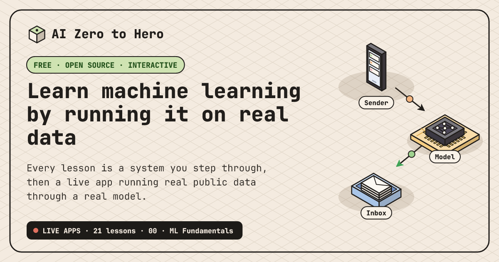
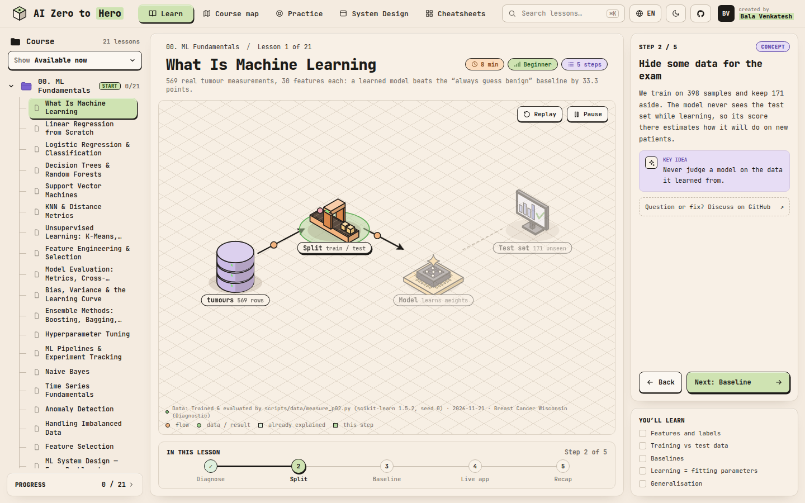
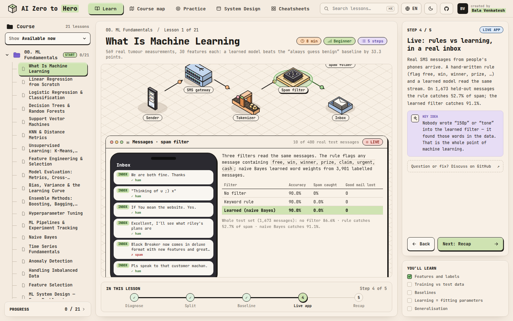
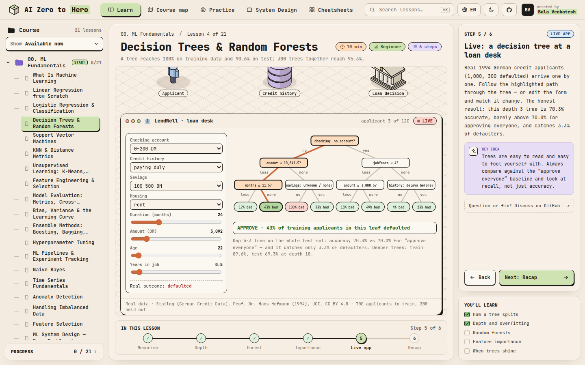
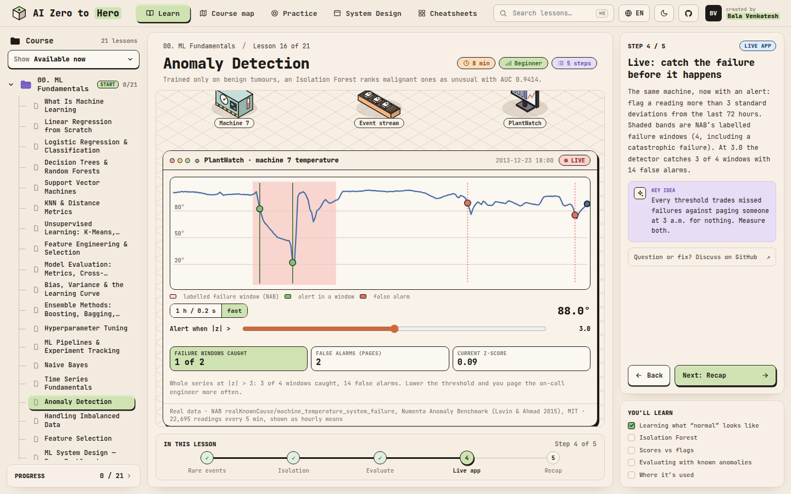
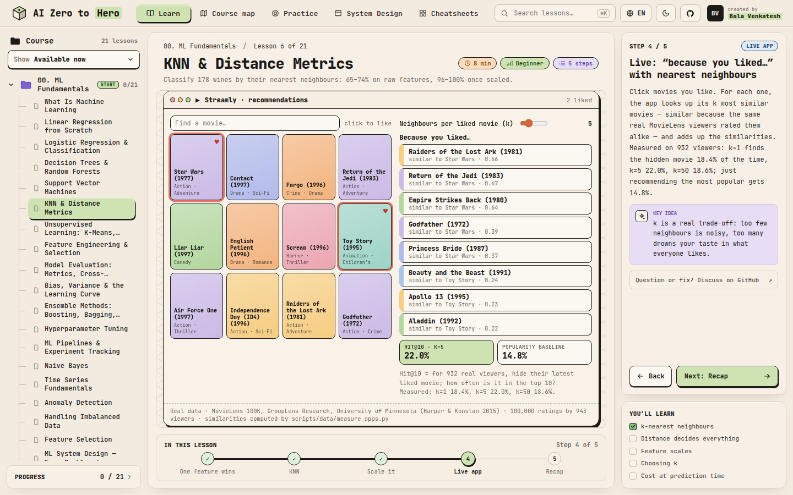
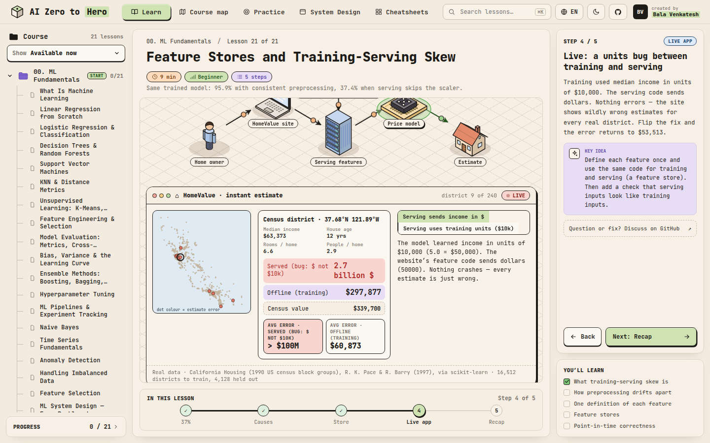
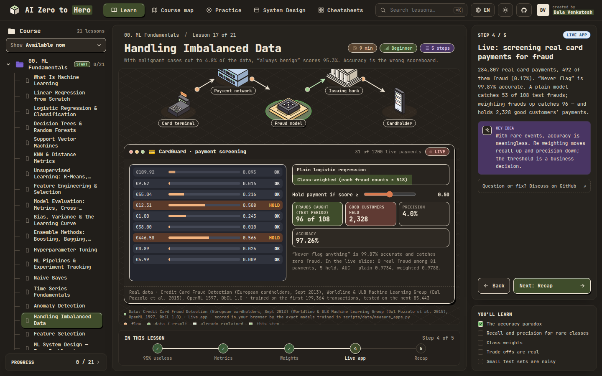
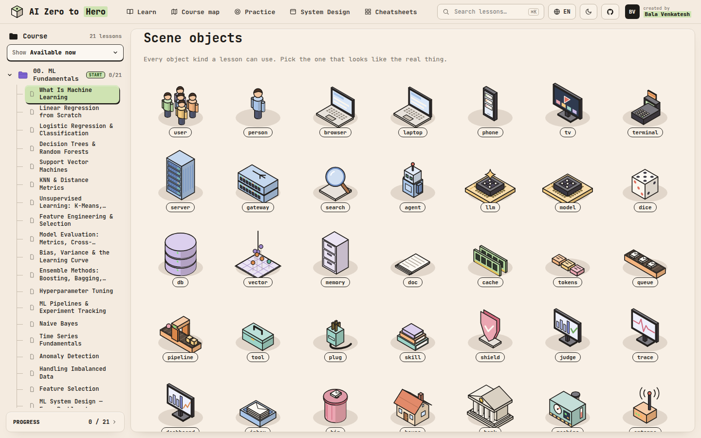

<p align="center">
  
</p>

<h1 align="center">AI Zero to Hero</h1>

<p align="center"><b>Learn machine learning by running it — every lesson ends in a live app powered by a real model on real data.</b></p>

<p align="center">
  <a href="https://ai-zero-to-hero.vercel.app"></a>
  <a href="LICENSE"></a>
  <a href="CONTRIBUTING.md"></a>
  
</p>

<p align="center">
  <a href="https://ai-zero-to-hero.vercel.app"><b>Start learning →</b></a> ·
  <a href="#screenshots">Screenshots</a> ·
  <a href="#run-it-locally">Run locally</a> ·
  <a href="CONTRIBUTING.md">Contribute</a>
</p>

---

## Why AI Zero to Hero

Most courses explain machine learning. This one lets you **watch it work**.

- **Systems, not slides.** Each idea is an animated isometric diagram you step through — users, servers, databases and models that look like the real thing, with requests flowing between them.
- **A live app in every lesson.** The final step drops you into a working product — a spam filter, a home-value estimator, a movie recommender, a loan desk, a factory monitor, a fraud screen — running a real trained model in your browser.
- **Real numbers only.** Every metric on screen is measured, never invented, and the models in the browser are verified against the originals.
- **Hands on.** Type your own message, edit a loan application, like movies, drag a threshold — and see the model react instantly.
- **Free and open source.** No sign-up, no paywall. Progress stays in your browser.

## Screenshots

<table>
  <tr>
    <td width="50%"><br /><sub><b>Lesson player</b> — step through an animated system, one idea at a time.</sub></td>
    <td width="50%"><br /><sub><b>Live app · spam filter</b> — real messages arrive and a learned model sorts them.</sub></td>
  </tr>
  <tr>
    <td><br /><sub><b>Live app · loan desk</b> — follow each applicant’s path through a decision tree.</sub></td>
    <td><br /><sub><b>Live app · machine monitoring</b> — catch a real failure before it happens.</sub></td>
  </tr>
  <tr>
    <td><br /><sub><b>Live app · recommender</b> — “because you liked…” with nearest neighbours.</sub></td>
    <td><br /><sub><b>Live app · home values</b> — see a training/serving bug break every estimate.</sub></td>
  </tr>
  <tr>
    <td><br /><sub><b>Dark mode</b> — card-fraud screening with a live threshold.</sub></td>
    <td><br /><sub><b>Object library</b> — 39 realistic isometric objects for building lessons.</sub></td>
  </tr>
</table>

## Curriculum

| # | Module | Status |
|---|---|---|
| **00** | **ML Fundamentals** — 21 lessons, each with a live app | ✅ Live |
| 01 | Deep Learning Core | 🔜 Coming soon |
| 02–17 | Vision, NLP, transformers, LLMs, RAG, agents, MCP, evaluation, safety, production and AI system design | 🔜 Coming soon |

ML Fundamentals covers: what ML is · linear & logistic regression · decision trees & forests · SVMs · KNN · clustering · feature engineering · evaluation · bias & variance · ensembles · hyper-parameter tuning · pipelines · naive Bayes · time series · anomaly detection · imbalanced data · feature selection · ML system design · monitoring & drift · feature stores & training-serving skew.

Also on the roadmap: **Course map**, **Practice** (graded incident drills), **AI System Design** case studies and **Cheatsheets**.

## Features

- 🧭 **Step-through lessons** with draw-in arrows, flowing requests, replay and pause, and keyboard controls (`←` `→` `R` `Space`, `[` `]` to hide the side panels)
- ⚡ **Live apps** that run trained models fully in the browser, lazy-loaded per lesson
- 🧱 **Realistic isometric objects** drawn from real 3-D geometry, consistent in light and dark themes
- 🔗 **Shareable URLs** for every lesson and step, with generated preview cards for social links
- 🔍 **SEO-ready**: prerendered pages, canonical URLs, sitemap, structured data, web manifest
- ♿ **Accessible**: real buttons and links, keyboard navigation, reduced-motion support
- 📱 **Responsive** from phone to wide desktop

## Run it locally

**Requirements:** Node.js 20+.

```bash
git clone https://github.com/balavenkatesh3322/ai-zero-to-hero.git
cd ai-zero-to-hero
npm install
npm run dev          # http://localhost:5173
```

| Command | What it does |
|---|---|
| `npm run dev` | Start the dev server with hot reload |
| `npm run build` | Type-check, build, and generate SEO pages, preview cards, icons and sitemap into `dist/` |
| `npm run preview` | Serve the production build locally |
| `npm run typecheck` | Run the TypeScript checker |
| `npm run check:apps` | Verify the in-browser models reproduce the trained originals |

## Project structure

```
src/
  apps/          Live apps (spam filter, home values, recommender, loan desk, monitoring, fraud, serving)
  lesson/        Lesson engine: stage, isometric objects (art.ts, iso.ts), widgets, stepper, step card
  lessons/       Lessons as data (concept steps + the live-app step for each lesson)
  components/    Header, sidebar, coming-soon screens, object gallery
  lib/           Course structure, routing, page metadata and SEO
  styles/        Design tokens (light & dark) and styles
scripts/
  data/          Reproducible scripts that train the models and measure every number
  seo/           Build-time generator for pages, preview cards, icons and sitemap
docs/
  spec.md        Product spec — the living source of truth
```

## How a lesson works

A lesson is plain data — no hand-built pages:

1. **Scene** — the objects on stage (`person`, `server`, `db`, `model`, …) and the links between them.
2. **Steps** — each step highlights objects, draws links, and shows a small widget (chart, table, quiz, code).
3. **Live app** — the last step before the recap swaps the diagram for the real production system and runs a working app.
4. **Recap** — a question / answer / because table.

Browse every available object at `/objects` and pick the one that looks like the real thing.

## Contributing

Contributions are very welcome — new lessons, live apps, fixes, translations and design polish.

1. Read [CONTRIBUTING.md](CONTRIBUTING.md) and the product spec in [`docs/spec.md`](docs/spec.md).
   Copy a sample PR: **[edit a lesson](docs/contributing/sample-pr-edit-lesson.md)** · **[add a lesson](docs/contributing/sample-pr-add-lesson.md)**.
2. Open an issue to discuss bigger changes first.
3. Fork, create a branch, and open a pull request.

**Ground rules:** every number must be measured and reproducible · use objects that look like the real thing · keep both light and dark themes working · run `npm run build` and `npm run check:apps` before you push.

## Creator

Built by **[Bala Venkatesh](https://balavenkatesh.is-a.dev/)** · [GitHub](https://github.com/balavenkatesh3322)

If this helps you learn, please ⭐ the repo and share it.

## License

[MIT](LICENSE) © 2026 Bala Venkatesh
